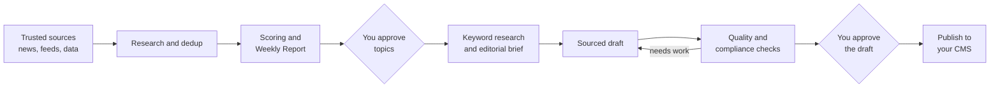

# Macy — Content Intelligence Engine

> **AI-assisted content you can trust. Every claim has a source. Nothing gets published without your approval.**

---

## The problem

B2B companies need a steady stream of useful, search-optimized content to reach decision-makers. Today there are two options, and both are bad:

| Approach | What goes wrong |
|---|---|
| **Writing by hand** | Slow and expensive. Hard to keep weekly. Research gets skipped, and topics are picked on a hunch. |
| **One-prompt "AI writers"** | Fast, but generic, salesy, and risky. Statistics get **made up**, sources can't be checked, and off-brand claims end up published under your name. |

Neither one gives you **volume, quality, and accountability together**.

## The solution

**Macy** is an editorial engine that works like a disciplined content team. It reads trusted sources in your industry every week, finds the stories worth covering, and writes SEO-ready articles where **every fact links to a real source document**. It checks each draft for quality and brand compliance before you see it.

AI does the heavy lifting. **You keep control** at two key points: which topics get written, and what gets published.

---

## Who it's for

- **B2B marketing teams** that need consistent, authoritative blog content without hiring a full editorial staff.
- **Founders and product marketers** in niche industries (like optical retail, Macy's launch vertical) where generic AI content isn't credible.
- **Agencies** that run content for several clients and need each one kept separate, with its own brand voice and budget.
- **Regulated or reputation-sensitive brands** where one made-up statistic or off-brand promise is a real risk.
- **Teams already using AI assistants** (Claude, Cursor, Antigravity, and others) that want those agents to work inside a governed editorial process instead of writing on their own.

---

## Why Macy is different

### 🔗 Every fact is traceable
Each factual claim in a draft is linked to the exact source document it came from. You can open a **Claims & Sources** table and check any statement in one click. Macy won't present a fact without evidence, and it never marks an unconfirmed publication date as verified.

### 🧑‍⚖️ Humans decide, AI executes
There are two required approval gates:
1. **Topic approval.** You pick which recommended topics get written, up to your weekly article quota.
2. **Draft approval.** You review the final article, its sources, quality findings, and cost before anything is published.

### ✅ Independent quality control
Drafts go through two layers of review before reaching you:
- **Automatic checks (free, instant).** Correct language, source freshness, working citation links, keyword placement, meta title/description and slug format, word count for the chosen format, banned brand phrases, and how pushy the call-to-action is.
- **Separate AI reviewer.** A separate model scores the draft against an editorial rubric. It never sees the writer's instructions, so it can't simply agree with itself.

Drafts that fall short are revised automatically (up to two rounds) or rejected. **You only review work that passed.**

### 🎯 Data-driven topic selection
Macy doesn't guess what to write about. It scores each opportunity with weights you control (relevance, timeliness, search potential, and so on) and backs it with real keyword data. Every week you get a **Top 10 report** with clear recommendations.

### 🗣️ Always on-brand
Your **Brand Profile** sets voice, positioning, real product capabilities, prohibited claims, banned phrases, and call-to-action rules. It's versioned, so you can see how your guidelines change over time, and Macy enforces it on every draft.

### 💰 No surprise bills
Every AI and API call is logged with its exact cost. You set **per-run and monthly spend caps**, and Macy stops *before* going over them. The dashboard shows cost per run, per article, and per month, plus a live estimate while you configure a campaign.

### 🌎 Bilingual from day one
Both the interface and content generation work in **Portuguese (Brazil)** and **English (US)**, and you can set each one separately.

---

## Features at a glance

### Research & strategy
- **Trusted source management.** Curate news sites, company blogs, data providers, and management publications, with trust tiers (1–3) and health monitoring.
- **Automatic weekly research.** Macy polls RSS feeds and runs targeted searches inside your trusted domains, then extracts clean article text, authors, and dates (respecting `robots.txt`).
- **Smart deduplication.** It catches duplicate stories and checks your **existing blog** (via sitemap import) so you don't cover the same topic twice.
- **Opportunity scoring and Weekly Report.** A ranked Top 10 list with recommendations sized to your weekly volume.
- **Keyword research.** Search volume and keyword metrics (via DataForSEO), cached to save cost and clearly labeled when a figure is an estimate.

### Content production
- **Editorial briefs.** Structured briefs that combine the chosen topic, target keywords, supporting evidence, and your campaign goal.
- **Sourced article drafts.** SEO-ready articles with FAQ, call-to-action, meta data, and claim-by-claim provenance.
- **Format sizing.** Choose short, standard, or long blog formats, and target funnel stages (awareness, consideration, decision).
- **Automatic revision loop.** Drafts that fail quality checks are reworked before they reach you.
- **Import your own drafts.** Upload an existing `.md` or `.pdf` article and run it through the same compliance checks (`deterministic_only` zero-AI mode supported, including stateless CLI/MCP `--stateless` execution).

### Review & publishing
- **Draft Review screen.** Markdown preview, Claims & Sources table, quality findings, revision history, and cost in one view.
- **Flexible publishing.** Export clean Markdown files with front-matter, or send signed requests to **n8n** or any CMS (WordPress, Webflow, headless CMSs, and more).
- **Staging safety.** In test environments, publishing is forced to "draft" mode so nothing goes live by accident.

### Automation & integrations
- **Scheduled runs.** Set a weekly schedule per campaign, or trigger a run on demand.
- **Outbound webhooks.** Signed notifications (Standard Webhooks, HMAC-SHA256) when topics are ready, drafts need review, or articles are published. Connect them to Slack, n8n, email, or your own tools. Includes a delivery log and one-click re-send.
- **Bring your own providers.** Choose your AI models per stage through OpenRouter, any OpenAI-compatible provider, or local zero-key Ollama (`pocket_free`, `local_ollama`, and `pro_cloud` stack presets), plus zero-key Google News RSS & Autocomplete or Brave & DataForSEO. Credentials are encrypted and tested from the UI.
- **AI-agent ready (MCP server).** Macy exposes its tools through the **Model Context Protocol** (`stdio`, HTTPS `streamable-http`, and zero-DB `--stateless` `stdio`), so AI assistants like Claude, Cursor, or Antigravity can research, draft, run compliance checks, or audit URLs while respecting your capability switchboard and human approval gates.

### Administration & security
- **Multi-workspace.** Run several brands or clients from one installation, each with isolated data, settings, capability toggles (`core-compliance`, `seo-audit`, `editorial-pipeline`, `route-monitors`), and budgets.
- **Google OIDC & local PBKDF2 sign-in.** Supports local email/password auth (`AUTH_MODE=local|auto` with rate limiting) for Pocket setups or Google OIDC in team/production deployments; only authorized owners can approve topics and drafts.
- **Privacy and retention.** Data retention policies, user anonymization, and purge tools aligned with LGPD.
- **Production-grade operations.** Docker-based deployment, automated backups, error monitoring, and health checks.

---

## A typical week with Macy

| When | What happens | Your time |
|---|---|---|
| **Monday, automatic** | Macy collects the week's industry news, removes duplicates, and scores every opportunity. | 0 min |
| **Monday** | You get a notification. Open the Weekly Report and approve 1–3 topics. | ~5 min |
| **Automatic** | Macy builds keyword-backed briefs, writes sourced drafts, and runs quality checks and revisions. | 0 min |
| **Mid-week** | You review each draft: read it, spot-check the Claims & Sources table, and approve. | ~10 min per article |
| **On approval** | The article is published to your CMS and your team is notified. | 0 min |

**The result:** a reliable publishing schedule of credible, on-brand, SEO-optimized content, for about the time it takes to read it.

---

## What you get vs. typical AI writing tools

| | Generic AI writer | **Macy** |
|---|---|---|
| Topic selection | You guess | Scored from real industry news and keyword data |
| Facts and statistics | Often made up | Every fact linked to a source document |
| Quality control | None, or self-review | Automatic checks plus an independent AI reviewer |
| Brand compliance | Prompt and hope | Enforced rules, banned phrases, CTA limits |
| Human oversight | Optional | Two required approval gates |
| Cost control | Unknown until the bill arrives | Per-call tracking with hard caps |
| Duplicate content | Common | Checked against news and your existing blog |
| Multi-brand / agency use | Separate accounts | Isolated workspaces in one install |
| Works with AI agents | Not applicable | MCP server with governed tools & stateless mode |

---

## Getting started

1. **Create your workspace** and invite your team.
2. **Set up your Brand Profile**: voice, positioning, capabilities, and things you must never say.
3. **Add trusted sources**, or start from a ready-made industry pack.
4. **Connect your providers**: AI models, search, keywords, and publishing destination.
5. **Configure a campaign**: language, market, articles per week, schedule, scoring priorities, and budget caps.
6. **Run your first week.** You can do a free offline test run first to see the full workflow with no API spend.

---

## Status

Macy's core editorial pipeline (`M0–M4`), Agent-Driven Mode compliance & MCP server (`M5-03–M5-08`), SEO/GEO audits, bounded crawler & route monitors (`M6-01–M6-03`), and Pocket zero-config runtime, zero-key adapters, capability switchboard, Path B stateless CLI/MCP, and 3-step URL onboarding (`M7-01–M7-04`) are **complete and tested**. Live VPS rollout and the 4-week editorial pilot remain gated only on external host/API credentials.

---

*Macy: research like an analyst, write like an expert, publish only what you approve.*
