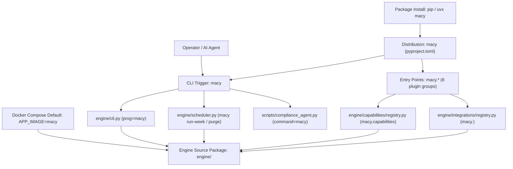

# ADR-033: Unified `macy` Package, CLI Trigger & Plugin Tooling Identity

**Status:** Accepted · **Date:** 2026-11-19 · **Deciders:** Project Maintainer
**Related:** features F01, F05, F18, F20, F21, F22, F23 · ADR-005, ADR-006, ADR-012, ADR-027, ADR-029, ADR-030, ADR-032

## Context

When Macy was initially scaffolded under M0, its Python distribution (`name = "content-engine"`), console script (`content-engine = "engine.cli:main"`), argparse program name (`prog="content-engine"`), plugin entry-point namespace (`content_engine.*`), default container image (`APP_IMAGE:-content-engine`), crontab entries, and Strands compliance wrapper were named generically `content-engine` / `content_engine`.

Now that Macy is published under `https://github.com/LesserWords/Macy` with an external private context overlay (`ADR-032`), the generic `content-engine` name creates concrete friction across developer experience, operations, and documentation:
1. **CLI & Tooling Lookup Ambiguity:** Operators installing via `uvx`, searching installed binaries (`which macy` / `Get-Command macy`), writing crontab schedules, or configuring MCP clients (`Antigravity`, `Claude Desktop`, `Claude Code`, `Cursor`) expect to invoke `macy`, not remember a generic second name (`content-engine`).
2. **Plugin Ecosystem Discoverability (`ADR-005`, `ADR-029`):** Third-party adapters registered under `content_engine.<port>` and `content_engine.capabilities` look unrelated to `macy` in external `pyproject.toml` manifests.
3. **Clean Break Preferred Over Legacy Aliasing:** Because Macy is at `v0.2.0` pre-1.0 OSS release and its maintainer wants canonical documentation without dual-command confusion, no deprecated `content-engine` compatibility shim should remain.

### Requirements Summary
- **Functional:** Replace the CLI command trigger, Python distribution name & extras (`macy[core]`, `macy[full]`, etc.), argparse `prog`, plugin entry-point groups (`macy.*`), generated scheduler crontabs, Strands agent MCP subprocess call, default Compose `APP_IMAGE`, active OpenSpec capability specs (`openspec/specs/**` + active changes), documentation, and remaining temporary `open-macy` GitHub URLs with `macy` / `LesserWords/Macy`.
- **Non-Functional:** Keep the internal Python source tree (`engine/`) and import contracts (`ADR-006`, `import-linter`) stable to avoid touching ~180 Python files; enforce zero-legacy-reference regression tests; maintain 100% `diff-cover` and `>= 90%` branch coverage.

## Architecture Diagram

## Options considered

| Option | Scope | Compatibility Impact | Complexity | Fit |
|---|---|---|---|---|
| **A. Clean-break `macy` distribution, CLI, `macy.*` entry-point groups, image default & docs while keeping `engine/` internal package** (chosen) | CLI trigger, distribution, entry points, defaults, active specs, docs | Breaking change for pre-M9 scripts, crontabs, MCP configs & external `content_engine.*` plugins (no alias shim) | Medium (~89 files, small code diff in `pyproject.toml` + 4 Python files) | High — single canonical name everywhere users look without destabilizing internal imports |
| B. Rename CLI binary only (`macy`) + keep `content-engine` alias, distribution name, `content_engine.*` entry points & image default | CLI entrypoint only | Fully backwards compatible | Low | Poor — perpetuates generic `content-engine` lookup in `uvx`, `pyproject.toml`, plugins & Docker defaults |
| C. Full internal Python module rename (`engine/` → `macy/`) | Everything including internal imports | Breaks all Python imports across ~180 source/test files, `import-linter`, `complexipy`, `vulture` | High | Poor — huge diff with zero user-facing CLI/tooling benefit over Option A |

## Decision

Adopt **Option A** as a clean-break milestone (`M9-01`–`M9-03`) with **no backwards-compatibility alias**:

1. **Distribution Package & Console Entrypoint (`pyproject.toml`, `uv.lock`, `engine/cli.py`):**
   - Set `[project].name = "macy"`, update `full` extra self-reference to `macy[core,editorial,ui,audit-browser]`, and replace `[project.scripts]` with `macy = "engine.cli:main"` (removing `content-engine`).
   - Keep `[tool.hatch.build.targets.wheel] packages = ["engine"]` so wheel contents remain `engine/*` while wheel/sdist archives build cleanly as `macy-<version>.whl` and `macy-<version>.tar.gz`.
   - Set `argparse.ArgumentParser(prog="macy")` in `engine/cli.py`.
2. **Plugin Entry-Point Groups (`pyproject.toml`, `engine/capabilities/registry.py`, `engine/integrations/registry.py`):**
   - Rename all 8 entry-point groups to the `macy.*` prefix (`macy.llm`, `macy.feed_source`, `macy.news_search`, `macy.extractor`, `macy.keyword_provider`, `macy.publisher`, `macy.analytics_source`, `macy.capabilities`).
   - Update `CAPABILITY_GROUP = "macy.capabilities"` in `engine/capabilities/registry.py` and `f"macy.{port}"` / `f"macy.{p}"` in `engine/integrations/registry.py`.
3. **Scheduling, Agent Runner, Compose & Env Defaults (`engine/scheduler.py`, `scripts/compliance_agent.py`, `infra/`, `.env*`):**
   - Emit `macy run-week` and `macy purge` in `engine/scheduler.py`.
   - Invoke `StdioServerParameters(command="macy", ...)` in `scripts/compliance_agent.py`.
   - Default `APP_IMAGE` to `macy` in `.env.example`, `infra/compose.yaml`, and `infra/compose.pocket.yaml`, and update CLI examples in `.env.prod.example` and `infra/deploy/prod/secrets.toml.example`.
4. **Canonical Specs, Documentation & Post-Rename URL Cleanup:**
   - Update all active OpenSpec capability specs (`openspec/specs/**`) and active pending changes (`openspec/changes/2026-11-10-m5-01{a,b,c}*/`) while preserving immutable `openspec/changes/archive/**` snapshots.
   - Update `README.md`, `CONTRIBUTING.md`, `docs/**` (excluding historical rationale in `ADR-033` and `M9.md`), and any lingering `LesserWords/open-macy` GitHub URLs (in `README.md`, `.github/ISSUE_TEMPLATE/config.yml`, and `M8` / `ADR-032` / `F23` / `runbook` references) to `LesserWords/Macy`.
   - Enforce a regression unit test asserting zero remaining `content-engine` / `content_engine` strings across code, packaging, infrastructure, active OpenSpec specs, and non-historical docs.

## Consequences

- **Easier:** New adopters install, invoke, search, and configure MCP/cron/plugins using one consistent `macy` identifier (`uvx macy[core]`, `macy mcp`, `macy audit`, `macy run-week`, `[project.entry-points."macy.llm"]`), and built distributions (`macy-*.whl`) match the GitHub repository name (`LesserWords/Macy`).
- **Harder (Risks & Mitigations):**
  - *Risk 1 — Active Windows IDE/MCP File Lock:* Removing `content-engine.exe` while an MCP client still runs `.venv/Scripts/content-engine.exe` fails `uv sync` with OS error 32. **Mitigation:** Update local MCP configs from `content-engine` to `macy`, restart/reconnect MCP host before `uv sync`, and verify `macy mcp --stateless --check`.
  - *Risk 2 — Existing Crontabs & VPS `APP_IMAGE` Tags:* Pre-M9 cron entries (`content-engine run-week` / `purge`) and VPS `.env` files with older image names will not match new defaults. **Mitigation:** Re-export crontab via `macy schedule --print-crontab` and pin `APP_IMAGE` explicitly in existing VPS `.env` files during rollout.
  - *Risk 3 — External Third-Party Plugins:* Any external package declaring `[project.entry-points."content_engine.*"]` stops being discovered without a group update. **Mitigation:** Document the breaking change prominently in developer/plugin guides and release notes.

## Revisit when

- Internal Python package import paths (`engine.*`) ever need publishing as an importable library SDK (`import macy`) alongside CLI/server usage.

## Action items

- [ ] `M9-01` — Update `pyproject.toml` (`name = "macy"`, `macy` CLI script, `macy.*` entry-point groups), regenerate `uv.lock`, update `engine/cli.py`, `engine/capabilities/registry.py`, `engine/integrations/registry.py`, `engine/scheduler.py`, `scripts/compliance_agent.py`, and corresponding unit/package tests.
- [ ] `M9-02` — Update `infra/compose*.yaml`, `.env*.example`, `secrets.toml.example`, active `openspec/specs/**` & `openspec/changes/2026-11-10-m5-01*/`, and leftover `LesserWords/open-macy` URLs to `LesserWords/Macy`.
- [ ] `M9-03` — Complete doc sweep across `README.md`, `CONTRIBUTING.md`, `docs/**`, add zero-legacy-reference regression test, verify synced `macy` CLI / MCP smoke, and pass `sh scripts/check.sh` + `tests/e2e/test_j_pocket_onboarding.py`.
