# M10 — Multi-Mode Production Hardening: Structured Draft Schema, Live Adapter Resilience & CLI Lifecycle Parity

Milestone M10 resolves the eight root-cause bugs and operational parity gaps uncovered during the end-to-end multi-mode validation across Mode 1 (Web UI), Mode 2A/2B (MCP Server HTTP & stdio), Mode 3A/3B (Headless CLI DB-backed & stateless), and Mode 4 (Zero-DB `--mock` MCP sandbox).

---

## Root-Cause Analysis & Issue Inventory

```mermaid
flowchart TD
    subgraph Mode1_2["Modes 1 & 2 (Web UI & MCP Full Editorial Lifecycle)"]
        B1["BUG-01: ContentDraft.faq / cta untyped dict[str, str]\nOpenRouter JSON_SCHEMA strict mode emits {}"]
        B2["BUG-02: evaluate._run_llm_rubric_call leaves resolved_adapter=None\nquality_reports.evaluator_model records 'fake-llm-v1' on live runs"]
        B4["BUG-04: RequiredFact.source_id & DraftClaim.source_id accept non-UUID str\nBypasses Instructor retry loop; fails post-call on title strings"]
        B5["BUG-05: AutocompleteKeywordProvider unguarded HTTP 400 / raw seed terms\nAborts _resolve_brief_keywords instead of falling back to estimation"]
        B6["BUG-06: research.collect_feed_sources & collect_site_search_sources\nSingle source HTTP 429/503 aborts entire research run"]
        B7["BUG-07: ServiceStoreAdapter.get_or_create_brief drops format_slug & funnel_stage\nDB-backed MCP brief generation ignores caller overrides"]
    end

    subgraph Mode2B_3["Modes 2B & 3 (External Draft Import & Headless CLI)"]
        B3["BUG-03: services._execute_import_external_draft hardcodes offline=True\nmacy import-draft & macy_import_draft always use FakeLLM"]
        B8["BUG-08: cli.main checks any('pytest' in arg for arg in sys.argv)\nPaths under pytest tmp_path print help & exit 0; missing CLI stage verbs"]
    end

    B1 --> M10_01["M10-01: Typed FAQItem/DraftCTA Schema,\nEvaluator Model Label & Live Import Eval"]
    B2 --> M10_01
    B3 --> M10_01

    B4 --> M10_02["M10-02: Provenance UUID Validator Retry,\nAutocomplete Fallback & Per-Source Isolation"]
    B5 --> M10_02
    B6 --> M10_02

    B7 --> M10_03["M10-03: MCP Brief Override Forwarding,\nCLI argv[0] Guard & CLI Lifecycle Verbs"]
    B8 --> M10_03
```



### Detailed Root-Cause Breakdown

| ID | Affected Mode(s) | Exact Code Location | Root Cause | Production Impact |
| :--- | :--- | :--- | :--- | :--- |
| **BUG-01** | Mode 1, Mode 2A, Mode 3A | `engine/contracts.py:227-228`, `engine/integrations/openrouter.py:62-65`, `engine/integrations/markdown_export.py:24-36,62-73` | `ContentDraft` defines `faq: list[dict[str, str]]` and `cta: dict[str, str]`. In Pydantic's JSON Schema output, untyped `dict[str, str]` emits `{"type": "object", "additionalProperties": {"type": "string"}}` with no `properties`. When `OpenRouterLLM` runs with `instructor.Mode.JSON_SCHEMA`, strict schema compilation strips open `additionalProperties` and sets `additionalProperties: false` on objects without declared `properties`, grammar-constraining the model to output `faq: [{}, {}]` and `cta: {}` while writing the FAQ and CTA inside `body_md`. | Every live LLM draft fails `clarity_and_structure` (`major`: empty `faq` and `cta`), triggering two unnecessary revision loops (`revision 0 -> 1 -> 2`), tripling LLM write + evaluate token spend, and ending in `verdict="revision"` with missing structured FAQ/CTA sections in exported Markdown. |
| **BUG-02** | Mode 1, Mode 2A, Mode 3A | `engine/quality/evaluate.py:339-349,394-410,633-652` | When `_execute_evaluate` runs with `spec.offline=False` and `spec.llm_adapter=None`, `resolved_llm` stays `None` because `conn is not None`. Inside `_run_llm_rubric_call`, `llm.structured_call` internally resolves the workspace `OpenRouterLLM` from `workspace_integrations` and executes the real API call, but `_run_llm_rubric_call` passes `resolved_adapter=None, model=None` to `_resolve_model_label`, which falls back to `"fake-llm-v1"` at line 348. | All persisted `quality_reports` rows from live DB-backed runs record `evaluator_model = "fake-llm-v1"` even when evaluated by a live OpenRouter model, corrupting audit provenance. |
| **BUG-03** | Mode 2B, Mode 3A | `engine/services.py:5842-5851,5925-5960`, `engine/cli.py:394-433`, `engine/mcp/tools_editorial.py:123-165` | `_execute_import_external_draft` hardcodes `"offline": True` at `engine/services.py:5848` when delegating to `_execute_evaluate_draft`. | `macy import-draft` (without `--deterministic-only`) and MCP `macy_import_draft(..., deterministic_only=False)` silently bypass the workspace's configured `OpenRouterLLM` and always evaluate imported drafts with `FakeLLM()`. |
| **BUG-04** | Mode 1, Mode 2A | `engine/contracts.py:180-185,204-217`, `engine/strategy/brief.py:671-687`, `engine/production/writer.py:254-270` | `RequiredFact.source_id: str \| uuid.UUID` and `DraftClaim.source_id: str \| uuid.UUID \| None` accept arbitrary strings in Pydantic. When a live model cites a human-readable source name or title instead of the document UUID in `source_id`, Pydantic validation succeeds on attempt 1 inside `instructor` (bypassing `max_retries=2`), and post-call `validate_brief_evidence_references` / `validate_draft_claim_provenance` immediately raises `InvalidEvidenceReferenceError` / `InvalidDraftProvenanceError`. | Transient LLM citation of a source title instead of its UUID aborts brief or draft generation immediately instead of triggering Instructor's structured validation retry or resolving unambiguous title matches. |
| **BUG-05** | Mode 1, Mode 2A | `engine/integrations/autocomplete_keywords.py:74-112`, `engine/strategy/brief.py:470-505,543-602` | `_collect_candidate_seed_terms` slices raw 6-word prefixes from `headline` and raw `entities` (including colons, em-dashes, quotes, or long strings). If `suggestqueries.google.com` returns HTTP 400/429/5xx on any single seed term inside `AutocompleteKeywordProvider.lookup()`, `suggest_related()` raises `ValueError`. `_resolve_brief_keywords()` only catches `IntegrationMissing`, letting the HTTP error abort brief generation. | A single malformed seed term or transient autocomplete HTTP error crashes `macy_get_editorial_brief` / `services.generate_brief` instead of falling back to `_estimate_keywords_with_cache()`. |
| **BUG-06** | Mode 1, Mode 2A, Mode 3A | `engine/research.py:410-503` | `collect_feed_sources` (line 437) and `collect_site_search_sources` (line 485) iterate over enabled sources without per-source exception isolation. | A single external feed timeout or Google News RSS `HTTP 429 Too Many Requests` after multiple rapid `site:` queries aborts the entire `macy run-week` or `macy_research_topic` run and marks the run `'failed'`, discarding all documents already fetched from healthy sources. |
| **BUG-07** | Mode 2A | `engine/mcp/server.py:150-157`, `engine/services.py:2915-2965,5316-5402`, `engine/strategy/brief.py:33-42,639,653,720-764` | `BriefRequest` and `macy_get_editorial_brief` accept `format_slug: str = "blog"` and `funnel_stage: str \| None = None`, and `MockStore.get_or_create_brief` honors both. However, `ServiceStoreAdapter.get_or_create_brief` drops both fields and calls `services.get_or_create_mcp_brief(conn, workspace_id=..., topic_id=...)`, which hardcodes `format_pack="blog"` and uses the scored opportunity's `funnel_stage`. | Calling `macy_get_editorial_brief(topic_id=..., funnel_stage="mofu", format_slug="linkedin_post")` against a live DB workspace ignores the caller's `funnel_stage` and `format_slug` overrides if the scorer tagged the topic `"tofu"` or `"bofu"`. |
| **BUG-08** | Mode 3A, Mode 3B | `engine/cli.py:527-918` (`line 902`) | 1) `engine/cli.py:902` checks `if args is None and any("pytest" in arg for arg in sys.argv): parser.print_help(); return 0`. Any CLI invocation passing a file path containing `"pytest"` (such as pytest's `tmp_path` directory) prints `--help` and exits `0`. 2) `engine/cli.py` exposes `run-week` and `import-draft`, but lacks granular stage subcommands (`decide-topic`, `brief`, `write`, `evaluate`, `decide-draft`, `publish`) to step through a topic lifecycle headlessly from the terminal. | 1) CLI subcommands fail silently under any directory path containing `"pytest"`. 2) CLI users cannot approve a topic, generate a brief, write/evaluate a draft, or approve/publish a draft without dropping into Python or the MCP/Web interfaces. |

---

## Dependency Graph

```
M10-01 (Typed ContentDraft FAQ/CTA Schema, Evaluator Model Label & Live External Draft Eval)
  │
  ▼
M10-02 (Provenance UUID Validator Retry, Autocomplete Keyword Fallback & Research Fault Isolation)
  │
  ▼
M10-03 (MCP Brief format_slug/funnel_stage Forwarding, CLI argv[0] Guard & CLI Editorial Subcommands)
```

---

### M10-01 — Typed `ContentDraft` FAQ/CTA Schema, Evaluator Model Label & Live External Draft Evaluation

- **Features**: F6.1 (Draft Production & Provenance), F7.2 (Isolated Quality Evaluator), F9.4 (External Draft Compliance Import)
- **ADRs**: ADR-003 (Structured Outputs via Instructor & Pydantic), ADR-006 (Deterministic + Isolated LLM Quality Gate)
- **Depends**: M9-04
- **Size**: M
- **Status**: Done

#### Context

1. `ContentDraft.faq` (`list[dict[str, str]]`) and `ContentDraft.cta` (`dict[str, str]`) in `engine/contracts.py:227-228` lack explicit JSON Schema `properties`, causing OpenRouter's `instructor.Mode.JSON_SCHEMA` grammar sampler to emit `{}` objects and triggering false-positive `clarity_and_structure` revision loops.
2. `engine/quality/evaluate.py` fails to resolve the active workspace `LLMPort` adapter before computing `evaluator_model` when `conn is not None` and `llm_adapter is None`, persisting `"fake-llm-v1"` on live OpenRouter evaluations.
3. `engine/services.py:_execute_import_external_draft` hardcodes `"offline": True` when calling `_execute_evaluate_draft`, preventing live LLM rubric evaluation during `macy import-draft` and `macy_import_draft`.

#### Red — Failing Tests First

1. **`tests/test_contracts.py` & `tests/test_production_writer.py`**:
   - Assert that `ContentDraft.model_json_schema()` emits explicit `properties` (`question`, `answer`) for `faq` items and (`headline`, `body`, `button_text`) for `cta`, with zero open propertyless object schemas.
   - Assert backward compatibility: constructing `ContentDraft` with legacy dict formats (`faq=[{"q": "Q?", "a": "A."}]`, `cta={"text": "Book now", "url": "https://example.com"}`) or empty dicts coerces cleanly into `FAQItem` / `DraftCTA` (and supports `.get(...)` / dict-style access or clean serialization so existing callers in `engine/integrations/markdown_export.py`, `engine/production/schema.py`, and `engine/quality/evaluate.py` work seamlessly).
2. **`tests/test_quality_evaluate.py`**:
   - Add a test where `evaluate(..., conn=db_conn, workspace_id=ws_id, offline=False, llm_adapter=None)` runs with a workspace-configured `LLMPort` adapter (returning `model = "anthropic/claude-sonnet-5.5"`) and assert that both the returned `QualityReport.evaluator_model` and the persisted `quality_reports.evaluator_model` column equal `"anthropic/claude-sonnet-5.5"` (not `"fake-llm-v1"`).
3. **`tests/test_import_external_draft.py`**:
   - Add a test verifying that `services.import_external_draft(db_conn, workspace_id=ws_id, title=..., body_md=..., deterministic_only=False)` forwards `"offline": False` (by default) to `_execute_evaluate_draft`, invoking the workspace's configured LLM adapter rather than forcing `FakeLLM()`, while still supporting `offline=True` when explicitly requested.

#### Green — Implementation

1. **`engine/contracts.py:219-235`**:
   - Define `FAQItem(BaseModel)` with fields `question: str = Field(..., min_length=1)` and `answer: str = Field(..., min_length=1)`, plus a `@model_validator(mode="before")` accepting legacy keys (`q`/`title` -> `question`, `a`/`text` -> `answer`) and a helper `.get(key, default=None)` / `__getitem__` or dict-coercion method for backward compatibility with existing dict callers.
   - Define `DraftCTA(BaseModel)` with fields `headline: str = Field(..., min_length=1)`, `body: str = ""`, and `button_text: str = ""`, plus a `@model_validator(mode="before")` mapping legacy dict keys (`text`/`title`/`cta` -> `headline`, `description`/`goal`/`url` -> `body`, `button`/`action` -> `button_text`).
   - Update `ContentDraft`:
     - `faq: list[FAQItem] = Field(default_factory=list)`
     - `cta: DraftCTA | dict[str, str]` -> use `DraftCTA | None = None` (or `DraftCTA` with a default/validator that accepts `{}` in offline/test fixtures and serializes cleanly).
   - Update `prompts/write_blog.md` to explicitly name `faq[].question`, `faq[].answer`, and `cta.headline`, `cta.body`, `cta.button_text`.
   - Update `engine/integrations/markdown_export.py:24-36,62-73`, `engine/production/schema.py`, and `engine/quality/evaluate.py` to support both `FAQItem` / `DraftCTA` attributes and dict access.
2. **`engine/quality/evaluate.py:339-349,394-410,633-652`**:
   - In `_run_llm_rubric_call` (or `_execute_evaluate` when `not spec.offline`), resolve the effective adapter via `llm._resolve_llm_adapter(conn, workspace_id, resolved_adapter)` before calling `_resolve_model_label(effective_adapter, model)` so `evaluator_model` reflects the actual workspace LLM model name.
3. **`engine/services.py:5842-5851,5925-5960` & `engine/cli.py:394-433`**:
   - In `_execute_import_external_draft`, replace hardcoded `"offline": True` at line 5848 with `"offline": bool(params.get("offline", False))`.
   - Add `offline: bool = False` to `services.import_external_draft(...)` and `--offline` flag to `macy import-draft` in `engine/cli.py`.

#### Verification

```bash
UV_NO_SYNC=1 uv run pytest tests/test_contracts.py tests/test_production_writer.py tests/test_quality_evaluate.py tests/test_import_external_draft.py --no-cov -vv
```

---

### M10-02 — Provenance UUID Validator Retry, Autocomplete Keyword Fallback & Per-Source Research Fault Isolation

- **Features**: F2.1 (Multi-Source Ingestion), F4.2 (Keyword Enrichment), F5.1 (Editorial Brief Provenance), F6.1 (Claim Provenance)
- **ADRs**: ADR-003 (Structured Outputs & Provenance Validation), ADR-005 (Pluggable Integration Ports & Graceful Degradation)
- **Depends**: M10-01
- **Size**: M
- **Status**: Done

#### Context

1. `RequiredFact.source_id` and `DraftClaim.source_id` (`engine/contracts.py:180-185,204-217`) do not validate UUID format inside Pydantic, so Instructor never retries when an LLM emits a source title instead of a UUID.
2. `AutocompleteKeywordProvider` (`engine/integrations/autocomplete_keywords.py:74-112`) and `_resolve_brief_keywords` (`engine/strategy/brief.py:470-505,543-602`) pass unsanitized punctuation-heavy seed strings to Google Autocomplete and fail the entire brief call if any single HTTP lookup raises `ValueError` or `SafeHTTPError`.
3. `collect_feed_sources` and `collect_site_search_sources` (`engine/research.py:410-503`) abort the entire research run if any single external feed or `site:` news search returns `HTTP 429` or `503`.

#### Red — Failing Tests First

1. **`tests/test_strategy_brief.py` & `tests/test_production_writer.py`**:
   - Test that `RequiredFact(fact="...", source_id="Not A UUID")` and `DraftClaim(claim_text="...", kind="fact", source_id="Source Name")` raise a Pydantic `ValidationError` instructing the caller to use a valid UUID from `evidence_documents[].id` (enabling Instructor's automatic retry loop).
   - Test that if an adapter bypasses Pydantic UUID coercion or cites an exact `evidence_documents` `title` / `source_name`, `validate_brief_evidence_references` / `validate_draft_claim_provenance` resolves unambiguous exact title matches or fails closed when ambiguous/unknown.
2. **`tests/test_autocomplete_keywords.py` & `tests/test_strategy_brief.py`**:
   - Test that `_collect_candidate_seed_terms` strips punctuation (`:`, `—`, `–`, `"`, `?`, `!`), normalizes whitespace, and caps seed terms at 60 characters.
   - Test that `AutocompleteKeywordProvider.lookup()` tolerates individual term HTTP failures when other terms succeed, and that `_resolve_brief_keywords()` catches `(ValueError, SafeHTTPError, OSError)` from live keyword providers, logs a warning, and falls back to `_estimate_keywords_with_cache()`.
3. **`tests/test_research.py`**:
   - Test that when 1 of 3 feed sources in `collect_feed_sources` or 1 of 3 `site:` queries in `collect_site_search_sources` raises `SafeHTTPError("HTTP 429")`, `research.collect()` logs a warning for the failing source, continues collecting the remaining 2 sources, and succeeds with the partial document set.

#### Green — Implementation

1. **`engine/contracts.py:180-185,204-217` & `engine/strategy/brief.py:671-687`**:
   - Add a `@field_validator("source_id")` on `RequiredFact` requiring a valid UUID string or `uuid.UUID` instance (`ValueError("source_id must be a valid UUID from evidence_documents[].id, not a source name or title")`).
   - In `DraftClaim.validate_claim_provenance`, validate that when `kind == "fact"`, `source_id` parses as a valid UUID (`uuid.UUID(str(self.source_id))`).
   - Update `prompts/brief.md` and `prompts/write_blog.md` to emphasize that `source_id` MUST be the exact 36-character UUID from `evidence_documents[].id`.
2. **`engine/integrations/autocomplete_keywords.py:74-112` & `engine/strategy/brief.py:470-505,543-602`**:
   - Add `_sanitize_seed_term(raw: str) -> str` in `engine/strategy/brief.py` to strip punctuation characters, collapse whitespace, and cap length at 60 chars before adding to candidate seeds.
   - In `AutocompleteKeywordProvider.lookup()`, wrap each per-term `_fetch_suggestions(cleaned)` call in `try/except (ValueError, SafeHTTPError, OSError):` so a single rejected query returns a zero-suggestion estimate (`search_volume=0, is_estimate=True`) if other terms succeed (raising only if every term fails).
   - In `_resolve_brief_keywords()` (`engine/strategy/brief.py:570-599`), catch `(IntegrationMissing, ValueError, SafeHTTPError, OSError)` around `provider.suggest_related` and `provider.lookup`, log a structured warning, and fall back to `_estimate_keywords_with_cache()`.
3. **`engine/research.py:410-503`**:
   - In `collect_feed_sources` (around line 437) and `collect_site_search_sources` (around line 485), wrap each per-source fetch/search iteration in `try/except Exception as exc:`, emit a structured `logger.warning("research_source_fetch_failed", extra={...})`, and continue processing the remaining sources.

#### Verification

```bash
UV_NO_SYNC=1 uv run pytest tests/test_strategy_brief.py tests/test_production_writer.py tests/test_autocomplete_keywords.py tests/test_research.py --no-cov -vv
```

---

### M10-03 — MCP Brief `format_slug`/`funnel_stage` Forwarding, CLI `sys.argv[0]` Pytest Guard & CLI Editorial Subcommands

- **Features**: F5.1 (Editorial Brief Generation), F8.1 (MCP Tools Parity), F9.1 (Headless CLI Lifecycle)
- **ADRs**: ADR-002 (Hexagonal Service Layer Shared by Web, MCP, and CLI)
- **Depends**: M10-02
- **Size**: M
- **Status**: Done

#### Context

1. `ServiceStoreAdapter.get_or_create_brief` (`engine/mcp/server.py:150-157`) drops `request.format_slug` and `request.funnel_stage`, so DB-backed `macy_get_editorial_brief` calls cannot override the format or funnel stage.
2. `engine/cli.py:902` checks `any("pytest" in arg for arg in sys.argv)` instead of inspecting `sys.argv[0]`, causing any CLI command with a `--file` path inside pytest's `tmp_path` directory to print `--help` and exit `0`.
3. `engine/cli.py` lacks direct CLI subcommands for stepping through individual editorial stages (`decide-topic`, `brief`, `write`, `evaluate`, `decide-draft`, `publish`) without writing Python scripts or spinning up an MCP client.

#### Red — Failing Tests First

1. **`tests/test_mcp_tools.py` & `tests/test_strategy_brief.py`**:
   - Test calling `macy_get_editorial_brief` through `ServiceStoreAdapter` on a topic originally scored as `"tofu"` or `"bofu"` with `funnel_stage="mofu"` and `format_slug="blog"` (or another format), verifying that the generated `EditorialBrief` reflects `funnel_stage == "mofu"` and the requested `format_slug`, and regenerates if an existing brief has a different `format` or `funnel_stage`.
2. **`tests/test_cli.py`**:
   - Test invoking `cli.main(["import-draft", "--stateless", "--file", "/tmp/pytest-of-user/pytest-0/draft.md", "--title", "Test", "--primary-keyword", "test", "--json"])` (with `args=None` and `sys.argv` patched to `["macy", "import-draft", "--stateless", "--file", "/tmp/pytest-of-user/pytest-0/draft.md", ...]`) and verify it executes `import-draft` instead of printing `--help`.
   - Test the new CLI subcommands (`macy decide-topic`, `macy brief`, `macy write`, `macy evaluate`, `macy decide-draft`, `macy publish`) in `--json` mode against an offline workspace lifecycle.

#### Green — Implementation

1. **`engine/mcp/server.py:150-157`, `engine/services.py:2915-2965,5316-5402`, `engine/strategy/brief.py:33-42,639,653,720-764`**:
   - Update `ServiceStoreAdapter.get_or_create_brief` to pass `format_slug=request.format_slug` and `funnel_stage=request.funnel_stage` to `services.get_or_create_mcp_brief`.
   - Update `services.get_or_create_mcp_brief`, `services.generate_brief`, and `strategy.brief` (`_BriefExecutionSpec`) to accept `format_slug: str = "blog"` and `funnel_stage: str | None = None`.
   - In `_execute_get_or_create_mcp_brief`, if an existing brief is found, return it only when its `format` matches `format_slug` and (if `funnel_stage` is explicitly provided) its `funnel_stage` matches `funnel_stage`; otherwise generate a new brief version with the requested overrides.
   - In `strategy.brief._execute_brief`, load `_safe_load_format_pack(spec.format_slug)` and resolve `effective_funnel_stage = (spec.funnel_stage or opp_ctx.get("funnel_stage") or "mofu").lower()`, applying it to both `opp_summary["funnel_stage"]` and `EditorialBrief.funnel_stage`.
2. **`engine/cli.py:902`**:
   - Change line 902 from:
     ```python
     if args is None and any("pytest" in arg for arg in sys.argv):
     ```
     to:
     ```python
     if args is None and Path(sys.argv[0]).stem.lower().startswith("pytest"):
     ```
3. **`engine/cli.py` (Editorial Stage Subcommands)**:
   - Register six thin CLI subcommands wrapping existing `engine.services` entry points with `--workspace`, `--json`, and `--offline` support:
     - `macy decide-topic --workspace <ws> --topic-id <id> --decision <approve|approved|reject|rejected> [--note <text>] [--json]` -> `services.decide_topic`
     - `macy brief --workspace <ws> --topic-id <id> [--format-slug <slug>] [--funnel-stage <tofu|mofu|bofu>] [--offline] [--json]` -> `services.get_or_create_mcp_brief`
     - `macy write --workspace <ws> --brief-id <id> [--offline] [--json]` -> `services.produce_and_evaluate_draft`
     - `macy evaluate --workspace <ws> --draft-id <id> [--deterministic-only] [--offline] [--json]` -> `services.evaluate_draft`
     - `macy decide-draft --workspace <ws> --draft-id <id> --decision <approve|approved|decline|declined> [--note <text>] [--json]` -> `services.decide_draft`
     - `macy publish --workspace <ws> --draft-id <id> [--channel <channel>] [--json]` -> `services.publish_draft`

#### Verification

```bash
UV_NO_SYNC=1 uv run pytest tests/test_mcp_tools.py tests/test_strategy_brief.py tests/test_cli.py tests/e2e/ --no-cov -vv
```
