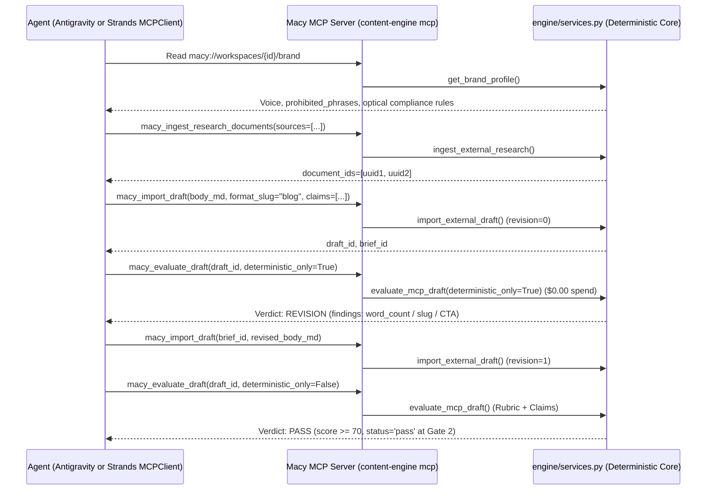

# Design: M5-08 — MCP "Modo A" Agent Tools & Strands Agents (`strands-agents`) Autonomous Runner

## Context & Architectural Constraints

All `M5-08` components adhere strictly to Macy's boundaries:
- **`engine/` Remains 100% Agent-Free (`ADR-002`):** No agent framework is imported inside `engine/`. External agents (whether interactive IDEs like Antigravity/Claude Code or headless `strands-agents` processes) interact with Macy exclusively through the `MCPServer` boundary (`ADR-027`).
- **Services Boundary (`ADR-014`):** `engine/mcp/` imports only `engine.services` and `engine.contracts` (`lint-imports`).
- **Parity Across Real Postgres and `--mock`:** Every new MCP tool (`macy_ingest_research_documents`, `macy_import_draft`) and parameter (`format_slug`, `funnel_stage`, `deterministic_only`) works identically on `ServiceStoreAdapter` (Postgres) and `InMemoryMCPStore` (`--mock`).

---

## Decisions

### Decision 1: MCP "Modo A" Tool Signatures (`tools_research.py` & `tools_editorial.py`)
- **`macy_ingest_research_documents` (`engine/mcp/tools_research.py`):**
  - Arguments: `workspace_id: str`, `documents: list[dict[str, Any]]`, `run_id: str | None = None`, `actor_email: str | None = None`, `actor_user_id: str | None = None`.
  - Delegates to `bundle.store.ingest_research_documents(IngestResearchRequest(...))` $\rightarrow$ `services.ingest_external_research(...)`.
- **`macy_import_draft` (`engine/mcp/tools_editorial.py`):**
  - Arguments: `workspace_id: str`, `body_md: str | None = None`, `file_path: str | None = None` (rejected on `streamable-http` for security; allowed on local `stdio`), `brief_id: str | None = None`, `title: str | None = None`, `slug: str | None = None`, `meta_description: str | None = None`, `primary_keyword: str | None = None`, `format_slug: str = "blog"`, `funnel_stage: str = "mofu"`, `faq: list[dict[str, str]] | None = None`, `cta: dict[str, str] | None = None`, `claims: list[dict[str, Any]] | None = None`, `sources: list[dict[str, Any]] | None = None`, `actor_email: str | None = None`, `actor_user_id: str | None = None`.
  - Delegates to `bundle.store.import_draft(ImportDraftRequest(...))` $\rightarrow$ `services.import_external_draft(...)`.
- **Extended Parameters on Existing Editorial Tools:**
  - `macy_get_editorial_brief`: add `format_slug: str = "blog"` and `funnel_stage: str | None = None`.
  - `macy_evaluate_draft`: add `deterministic_only: bool = False`.

### Decision 2: Headless Strands Agents MCP Runner (`scripts/compliance_agent.py`)
- **Files:** `pyproject.toml`, `scripts/compliance_agent.py`, `docs/MCP.md`.
- **Why Strands Agents (`strands-agents`):**
  - Native `MCPClient` + `MCPAgentTool` wraps all `macy_*` MCP tools automatically via `mcp_client.list_tools_sync()`.
  - Supports OpenRouter models (`OpenAIModel` pointed at `https://openrouter.ai/api/v1`) matching Macy's existing `OPENROUTER_API_KEY`.
  - Runs as a standalone CLI script (`uv run --extra agent python scripts/compliance_agent.py --workspace acme-demo --topic "..." --format blog`) without touching `engine/` or adding daemon containers.
- **Safety & Spend Invariants:**
  - All spend caps (`monthly_cap_usd`, `run_cap_usd`), SSRF guards (`safe_http`), FK claim constraints, and Gate 2 human approval rules remain strictly enforced by the Macy MCP server on every tool call made by the Strands agent.
  - `scripts/compliance_agent.py` enforces a bounded iteration/step guard (`max_revisions = 2`, matching PostgreSQL's `CHECK (revision BETWEEN 0 AND 2)` constraint, and an explicit tool-call step limit) so autonomous loops cannot spin indefinitely.
