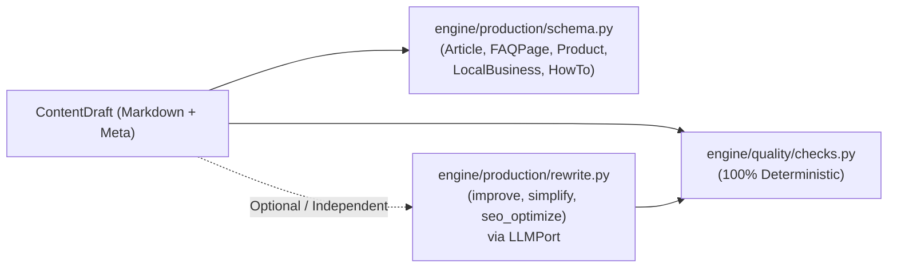

# Design: M6-01 — Content Readability, Keyword Density, JSON-LD Schema & Modular AI Rewrite

**ADR:** [ADR-028](../../../docs/adr/ADR-028-seo-audit-and-plan-toggles.md) · **Plan Item:** M6-01

## Architecture & Module Boundaries

`M6-01` strictly separates **deterministic QA/schema** from **LLM rewrite actions** so `deterministic_only=True` and offline tests have zero LLM coupling (`ADR-002`):

## Key Design Decisions

1. **Tiered Readability (`check_readability` in `engine/quality/checks.py`):**
   - **`en-US`:** `206.835 - 1.015 * (words / sentences) - 84.6 * (syllables / words)`
   - **`pt-BR` (Martins, Ghiraldelo, Nunes, & Oliveira Jr., 1996):** `248.835 - 1.015 * (words / sentences) - 84.6 * (syllables / words)`
   - **Portuguese syllable counter:** Vowel-group + hiatus/diphthong heuristic for `pt-BR` (accented vowels `áéíóúâêôãõàü` handled cleanly without heavy NLP models).
   - **Tiered threshold:**
     - `score >= 60`: `passed=True`
     - `40 <= score < 60`: `passed=False, severity="minor"` (advisory only; does not block `PASS`)
     - `score < 40`: `passed=False, severity="major"` (blocks `PASS` and triggers `REVISION`)
2. **Deterministic On-Page Checks (`engine/quality/checks.py`):**
   - `check_keyword_density`: `(occurrences / total_words) * 100`, target `0.5%–2.5%` (`minor` outside band, `major` if `0%` or `> 4.0%`).
   - `check_keyword_in_first_paragraph` & `check_keyword_in_headings`: normalized keyword match in first non-heading paragraph and `H2–H3` headings (`minor`).
   - `check_subheading_density`: at least `1` `H2`/`H3` per `300` words when `word_count >= 300` (`minor`).
3. **JSON-LD Schema Engine (`engine/production/schema.py`):**
   - Generators + validators for `Article`, `FAQPage`, `Product`, `LocalBusiness`, and `HowTo` (`@context = "https://schema.org"`).
   - Validation logic (from `seo-audit-skill`): `@graph` flattening, required vs. recommended fields, nested object checks (`author.name`, `publisher.name`, `offers.price`), and `inLanguage` matching workspace locale.
4. **Modular LLM Rewrite Modes (`engine/production/rewrite.py`):**
   - Independent service `rewrite_draft(draft, mode, ...)` supporting `improve`, `simplify`, `seo_optimize` via `LLMPort` + `usage_ledger` spend tracking. Zero imports from `engine/quality/`.

## Failure Modes & Mitigations

- **Short/listicle drafts skewing sentence counts:** Skip Flesch when `word_count < 100` or `sentence_count < 3` (return `passed=True` with `skipped` metadata).
- **Schema field gaps (e.g., `Product` without `price`):** `generate_schema` returns explicit missing-field diagnostics rather than emitting invalid JSON-LD.
