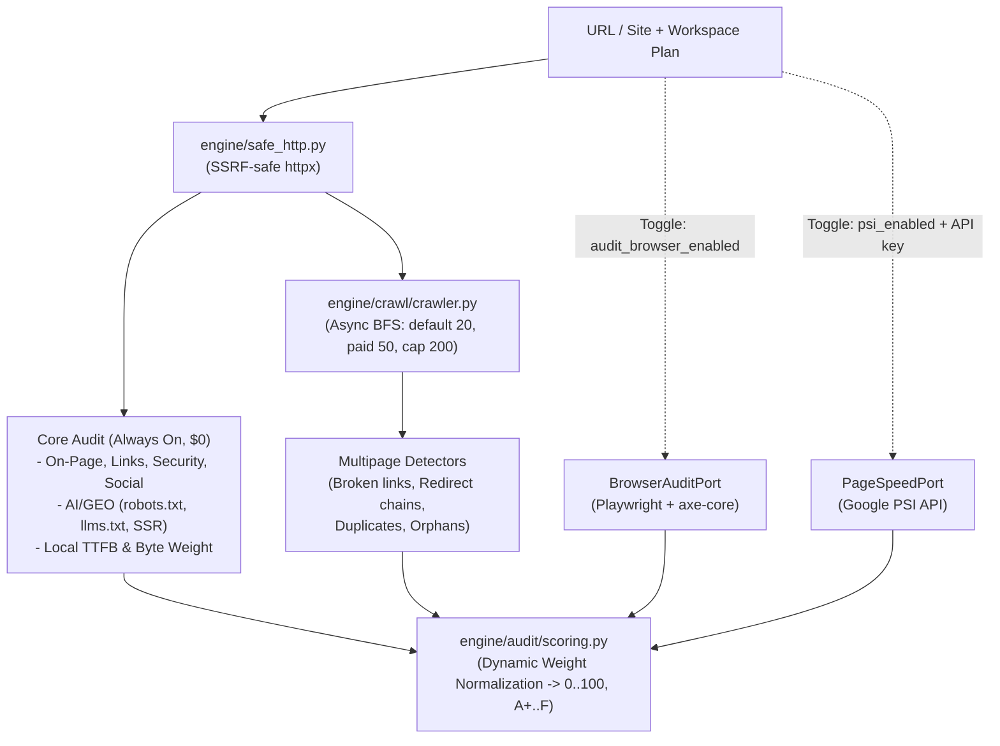

# Design: M6-02 — Non-WordPress URL & Bounded Site Audit Crawler

**ADR:** [ADR-028](../../../docs/adr/ADR-028-seo-audit-and-plan-toggles.md) · **Plan Item:** M6-02

## Architecture & Modular Toggles

## Key Design Decisions

1. **Flexible Plan-Based Crawl Limits:**
   - `CrawlConfig(max_pages: int = 20, hard_cap: int = 200)`:
     - Free default: `20` pages.
     - Paid plan entitlement (stored on workspace/plan config): `50` pages (configurable up to `hard_cap = 200`).
     - External broken-link checks capped at `100` unique external URLs per crawl (`HEAD` with `GET` fallback, 5s timeout) to stay within polite rate limits.
2. **Modular Optional Toggles (`Protocol` Ports):**
   - `BrowserAuditPort` (`axe-core` via Playwright): Registered only when `[audit-browser]` extra is installed and workspace toggle `axe_enabled=True`. Evaluates `image-alt`, `document-title`, `html-has-lang`, `heading-order`, `link-name`, `color-contrast`, `meta-viewport`.
   - `PageSpeedPort` (Google PageSpeed Insights): Registered when `psi_enabled=True` and API key is configured in `workspace_integrations`. Enhances `performance` category with LCP/CLS/INP; otherwise `performance` uses local TTFB (`<= 800ms`) + HTML/asset byte weight.
3. **Dynamic Score Normalization (`engine/audit/scoring.py`):**
   - Base category weights: `onpage (30)`, `performance (20)`, `usability (12)`, `security (12)`, `links (10)`, `social (8)`, `ai (8)`.
   - Only categories with >= 1 executed scored check contribute to the denominator, so toggling `axe-core` or `PSI` off never artificially penalizes the `0–100` score.

## Non-Functional Requirements & Failure Modes

- **SSRF & Politeness:** All fetches route through `engine/safe_http.py` (blocks private IPs/metadata endpoints); per-host concurrency `<= 2` with `250ms` jitter.
- **4 GB VPS Safety:** `audit-browser` extra is excluded from the default Docker image; `max_bytes = 3 MB` per HTML response prevents memory spikes.
- **Timeout Isolation:** If `PSI` or `axe-core` times out, the audit degrades gracefully to local checks with an `info` diagnostic rather than failing the whole audit.
