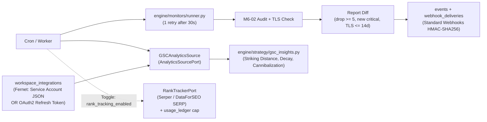

# Design: M6-03 — Post-Publish Monitoring, Hybrid GSC & Optional Rank Tracking

**ADR:** [ADR-028](../../../docs/adr/ADR-028-seo-audit-and-plan-toggles.md) · **Plan Item:** M6-03 (Phase 4)

## Architecture & Component Flow

## Key Design Decisions

1. **Hybrid GSC Auth on `AnalyticsSourcePort`:**
   - Credential union in `workspace_integrations` (`auth_mode: "service_account" | "oauth2"`):
     - `service_account`: Encrypted JSON key; zero token-expiry drift for unattended cron.
     - `oauth2`: Encrypted refresh token + client credentials; enables multi-property auto-discovery in Streamlit UI.
   - `URL Inspection API` responses cached for **12 hours** in Postgres to protect the `2,000/day` per-site quota.
2. **Route Monitor & Standard Webhooks Outbox:**
   - Reuses Macy's transactional `events` + `webhook_deliveries` (`standardwebhooks` HMAC-SHA256) — zero SMTP/mail-server ops surface.
   - Retry transient fetch/timeout errors **once after 30s** before classifying as down or emitting an alert.
   - Default alert rules: `score_drop >= 5`, any new `critical` finding, or `tls_days_left <= 14`.
3. **Paid `RankTrackerPort` Toggle:**
   - Gated by workspace entitlement `rank_tracking_enabled=True` + `usage_ledger` preflight spend check (`ADR-016`).

## Failure Modes & Mitigations

- **GSC OAuth2 token revoked / expired:** Emit `integration.auth_failed` event and mark integration unhealthy without crashing the weekly pipeline.
- **Transient origin flap during monitor run:** 30s single retry prevents false-positive `audit.critical_issue` webhooks.
- **Webhook endpoint down:** Existing exponential backoff + dead-letter handling in `engine/webhooks.py` handles retries.
