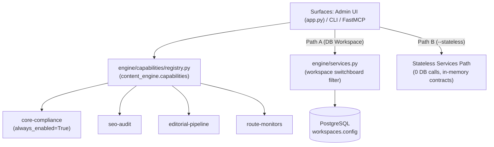

# Design: M7-01 — Capability Plugin Registry, Composable Extras & Path B Zero-Docker Stateless CLI/MCP

**ADR:** [ADR-029](../../../docs/adr/ADR-029-capability-plugins-and-switchboard.md) · **Plan Item:** M7-01

## Architecture & Module Boundaries

`M7-01` introduces a two-tier plugin architecture while preserving `import-linter` boundaries (`app.py`, `engine.cli`, and `engine.mcp` import `engine.services`, `engine.contracts`, and `engine.capabilities` only—never `engine.db`):

## Key Design Decisions

1. **Capability Metadata Contract (`engine/capabilities/ports.py`):**
   - Each plugin exports `CapabilityManifest(slug, title_msgid, always_enabled, required_ports, optional_ports, ui_screens, cli_commands, mcp_tools)`.
   - Backward compatibility: if `workspaces.config` does not contain `enabled_capabilities`, `get_enabled_capabilities()` returns all discovered built-in capability slugs so existing M0–M6 workspaces retain 100% existing behavior.
2. **Path B Stateless Service Separation (`--stateless` / `MACY_STATELESS=true`):**
   - `audit_url_stateless(url, ...)` invokes `engine/audit/` directly via `safe_http` without writing `site_audits` or `events` rows.
   - `crawl_site_stateless(url, max_pages=20)` executes `engine/crawl/` in memory and returns the `SiteCrawlResult` contract without requiring `workspaces` rows.
   - `evaluate_draft_stateless(...)` and `import_draft_stateless(...)` run `engine/quality/checks.py` and `engine/production/schema.py` deterministically with `0` DB queries and `0` LLM calls.
   - `content-engine mcp --stateless` boots FastMCP over `stdio` registering only `core-compliance` + `seo-audit` stateless handlers (`macy_audit_url`, `macy_crawl_site`, `macy_evaluate_draft`, `macy_import_draft`), returning `STATELESS_UNSUPPORTED` for DB-backed editorial mutations (`macy_decide_topic`, `macy_publish_draft`).
3. **Composable Packaging Extras (`pyproject.toml`):**
   - Keep `core-compliance` and `seo-audit` dependencies minimal (`pydantic`, `pyyaml`, `python-frontmatter`, `defusedxml`, `mcp`) while isolating `streamlit`, `babel`, `openai`, `instructor`, `pymupdf4llm`, `lingua-language-detector`, and `playwright` into optional extras (`[editorial]`, `[ui]`, `[audit-browser]`, `[full]`).

## Failure Modes & Mitigations

- **Accidental DB import or connection in Path B stateless mode:** Guard `get_connection` inside `--stateless` unit tests with a monkeypatch raising `AssertionError` so any accidental DB call fails CI immediately.
- **Disabling `core-compliance` or breaking existing workspaces:** Enforce `CORE_CAPABILITY_SLUG = "core-compliance"` server-side in `services.set_enabled_capabilities` and return all capabilities when `enabled_capabilities` is absent in `workspaces.config`.
