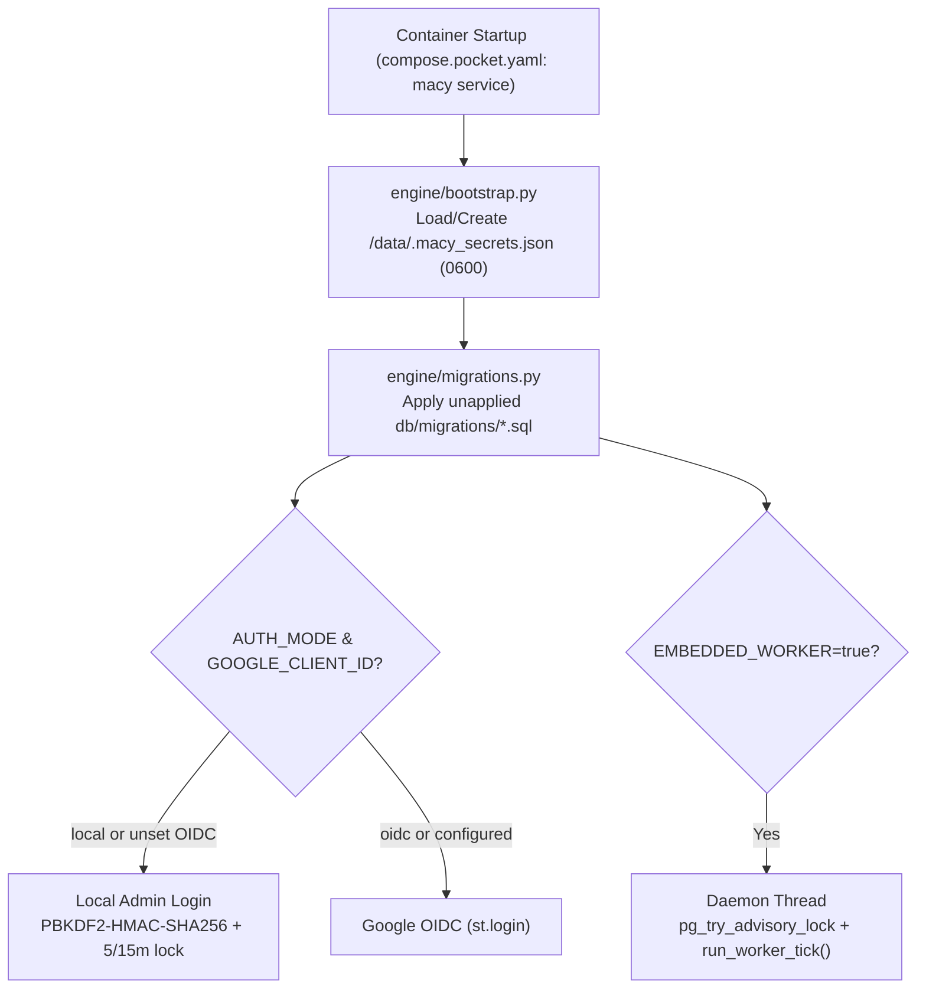

# Design: M7-02 — Path A: Macy Pocket Single-Container Runtime, Embedded Worker & Local Auth

**ADR:** [ADR-030](../../../docs/adr/ADR-030-pocket-single-container-and-local-auth.md) · **Plan Item:** M7-02

## Architecture & Boot Flow

## Key Design Decisions

1. **Non-Destructive Production Coexistence:**
   - `POCKET_MODE=true` is isolated to `compose.pocket.yaml` (or explicit PaaS env flags). `compose.prod.yaml` and `scripts/deploy.sh` remain strict fail-fast for multi-service VPS production deployments.
2. **Idempotent SQL Migration Parsing (`engine/migrations.py`):**
   - Reads the same `db/migrations/*.sql` files used by `dbmate`, extracting the `-- migrate:up` section (stopping at `-- migrate:down`), verifying/recording applied versions in `schema_migrations` within a transaction per file.
3. **PBKDF2-HMAC-SHA256 Password Storage (`engine/auth.py`):**
   - Uses Python standard library `hashlib.pbkdf2_hmac("sha256", password.encode("utf-8"), salt, 600_000)` with a 16-byte random salt encoded as `pbkdf2_sha256$600000$<salt_b64>$<hash_b64>`, adding zero external C-extension dependencies.
4. **Advisory-Locked Embedded Worker:**
   - Acquires a dedicated persistent connection holding `pg_try_advisory_lock(<MACY_WORKER_LOCK_ID>)` inside the daemon thread so multiple Streamlit sessions or restarts never launch duplicate worker loops.

## Failure Modes & Mitigations

- **Accidental secret regeneration wiping encrypted integrations:** Persist keys atomically (`tempfile` + `os.replace`) inside `${MACY_DATA_DIR:-/data}` and fail loudly if `/data` is read-only rather than generating ephemeral in-memory keys.
- **Unsafe DDL in `users.password_hash` migration:** Add `password_hash TEXT NULL` as a nullable column without table rewrites or default locks, verified by `squawk-cli`.
