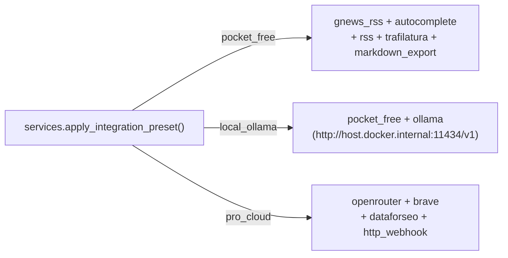

# Design: M7-03 — Zero-Key & Local Plug-and-Play Integration Adapters

**ADR:** [ADR-031](../../../docs/adr/ADR-031-zero-key-adapters-and-guided-onboarding.md) · **Plan Item:** M7-03

## Architecture & Adapter Matrix

## Key Design Decisions

1. **Universal OpenAI-Compatible & Ollama Adapter (`engine/integrations/openai_compat.py`):**
   - Reuses the already-installed `openai` + `instructor` dependencies without pulling heavy multi-vendor SDKs.
   - `ollama` explicitly sets `allow_local_loopback=True` in its settings validation ONLY for `localhost`/`127.0.0.1`/`host.docker.internal` Ollama ports while rejecting cloud metadata IPs (`169.254.169.254`) and private RFC1918 ranges on arbitrary `openai_compat` endpoints via `safe_http`.
2. **Google News RSS Search (`engine/integrations/gnews_rss.py`):**
   - Queries `https://news.google.com/rss/search` with explicit `hl`/`gl`/`ceid` parameters derived from `locale`/`market` (`pt-BR`/`BR` → `hl=pt-BR&gl=BR&ceid=BR:pt-419`, `en-US`/`US` → `hl=en-US&gl=US&ceid=US:en`), rejecting unsupported locales with `UnsupportedLocale`.
   - Parses XML strictly via `defusedxml` / `feedparser` with `safe_http` response caps and timeouts.
3. **Autocomplete Keyword Provider (`engine/integrations/autocomplete_keywords.py`):**
   - Queries public autocomplete JSON suggestions via `safe_http`, deduplicates and normalizes terms via existing `engine/seo/keywords.py` normalization rules, and returns `KeywordData(..., search_volume=0, is_estimate=True)` so downstream scoring/briefing explicitly labels volumes as estimates (`ADR-004`).

## Failure Modes & Mitigations

- **Public endpoint rate limiting (429 / transient 5xx):** Cap per-run query fan-out and rely on the 30-day `keyword_cache` + graceful empty-list fallback with logged telemetry.
- **SSRF bypass via `openai_compat` `base_url`:** Validate every custom `base_url` with `safe_http.validate_url()` before instantiating the client; only `ollama` permits explicit local loopback/Docker-host targets while blocking cloud metadata endpoints (`169.254.169.254`).
