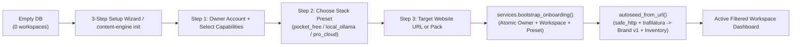

# Design: M7-04 — Path A: First-Boot 3-Step Setup Wizard & Website URL Auto-Seed Onboarding

**ADR:** [ADR-031](../../../docs/adr/ADR-031-zero-key-adapters-and-guided-onboarding.md) · **Plan Item:** M7-04

## Onboarding State Flow

## Key Design Decisions

1. **First-Boot Guard Against Unauthenticated Takeover:**
   - `bootstrap_onboarding` checks `COUNT(*) FROM workspaces == 0` inside the transaction (`SERIALIZABLE` or table lock guard). Once any workspace exists, unauthenticated first-boot onboarding is permanently locked out; secondary workspaces require an authenticated owner session.
2. **Deterministic URL Auto-Seeding (`engine/onboarding.py`):**
   - Uses `safe_http` (preventing SSRF on user-entered onboarding URLs) + HTML `<title>`/`<meta name="description">`/`<h1>`/`trafilatura` main text + `lingua-py` language detection to populate `BrandProfile` (`v1`) and seeds discovered sitemap URLs into `content_inventory`—requiring `$0` LLM spend.
3. **Resilient Fallback:**
   - If the entered URL times out, blocks bots, or the user chooses "Skip URL", `bootstrap_onboarding` still commits cleanly using the selected industry pack fixture (`general` or neutral default brand template) and surfaces a non-blocking notice.

## Failure Modes & Mitigations

- **SSRF via Setup Wizard URL input:** Validate all homepage and sitemap URLs through `safe_http` before fetching; fail closed on private, loopback, or metadata IP addresses.
- **Double-submit on Streamlit wizard completion:** Disable submit during execution and enforce unique workspace slug + empty-workspace lock so double-clicks cannot create duplicate workspaces or fail halfway.
